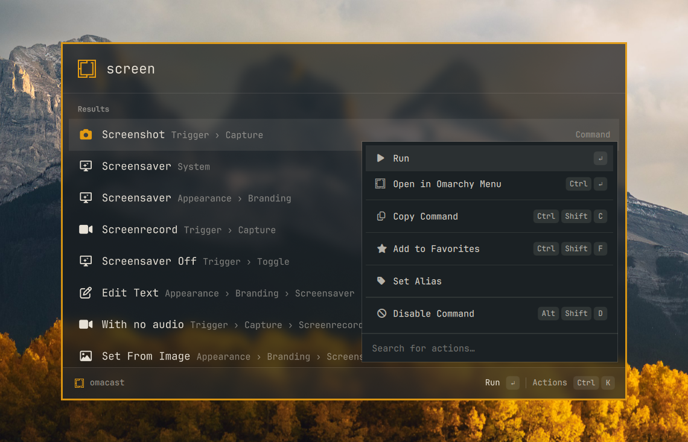
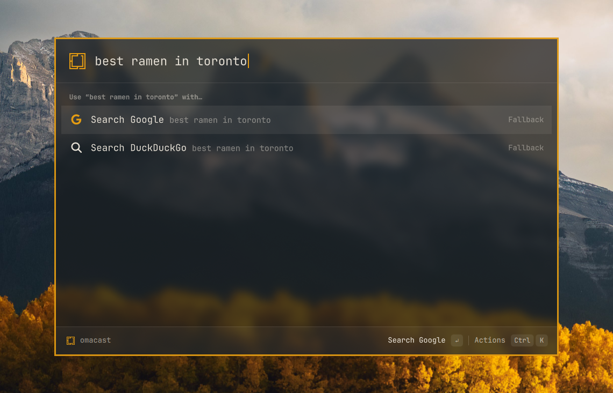

<div align="center">

# omacast

**A Raycast-esque launcher for [Omarchy](https://omarchy.org).**
It learns what you use, searches your apps and every Omarchy action, and looks like it shipped with your theme.


</div>

---

## Why

Omarchy's built-in menu is great at what it does. omacast adds what Raycast users miss on Linux:

* **Learns your habits.** Results are ranked with a port of Raycast's root-search algorithm, plus frecency and learned search terms. The things you actually use float to the top, and if you type `ff` and pick Firefox, `ff` keeps meaning Firefox.
* **One search for everything.** Your apps, all ~400 Omarchy menu actions (with breadcrumbs and live ✓ state), the files in your home folder, and web-search fallbacks.
* **File search.** Matching files and folders show up under Files. Search Files opens a full list with a preview of images and text, and the files you open rise to the top.
* **Your shortcuts.** Give anything an alias, pin favorites, and hide the commands you never touch.
* **Keyboard-first.** A Ctrl+K action panel, Ctrl+1–9 quick picks, search history on ↑, section jumping, and emacs-style navigation.
* **Native to Omarchy.** It runs inside `omarchy-shell` as a plugin, with no Electron, no Node and no extra daemons. It opens in about 40 ms and follows your theme live when you run `omarchy theme set`.

## Screenshots

<table>
  <tr>
    <td width="50%"></td>
    <td width="50%"></td>
  </tr>
  <tr>
    <td align="center"><b>Every Omarchy action, with breadcrumbs</b></td>
    <td align="center"><b>Ctrl+K: actions for any result</b></td>
  </tr>
</table>

<p align="center">
  
</p>
<p align="center"><b>No match? Send the query to Google or DuckDuckGo</b></p>

### Follows your Omarchy theme

There's no theme config. omacast binds to Omarchy's own colours, so it changes the moment you switch themes.


## Install

Requires Omarchy 4 (Hyprland 0.56+, `omarchy-shell`). Install it from the
[Omarchy plugin marketplace](https://plugins.omarchy.org), or with:

```sh
omarchy plugin add https://github.com/typecraft-dev/oma-cast --enable
~/.config/omarchy/plugins/typecraft.omacast/bin/omacast install   # link the omacast CLI into ~/.local/bin
omacast setup hyprland                                              # bind Alt+Space
omacast doctor                                                      # check everything is wired up
```

Press **Alt+Space**. Super+Space stays the Omarchy menu.

`omacast setup hyprland` lists what it will change and asks before changing it. It writes
`~/.config/hypr/omacast.lua` and appends one `require("hypr.omacast")` line to
`~/.config/hypr/hyprland.lua`; it never edits Omarchy's own files. To use another key, edit
`omacast.lua`; setup never overwrites one that already exists. To bind it yourself instead, add
this to your Hyprland config:

```lua
o.bind("ALT + SPACE", "omacast launcher", hl.dsp.global("omacast:toggle"))
```

Update with `omarchy plugin update typecraft.omacast`.

### Remove

```sh
omacast uninstall      # asks to remove the hotkey, then runs: omarchy plugin remove typecraft.omacast
```

Or remove it by hand: `omarchy plugin remove typecraft.omacast`, then delete `~/.config/hypr/omacast.lua`
and the `require("hypr.omacast")` line in `~/.config/hypr/hyprland.lua`, and `~/.local/bin/omacast`.
Your data stays until you delete it: `~/.config/omacast`, `~/.local/share/omacast`, `~/.cache/omacast`
and `~/.local/state/omacast`.

### Dependencies and network access

omacast needs only what Omarchy ships: `omarchy-shell` (Quickshell), Hyprland, bash, `jq`, `socat` and `fd`.
It adds no packages and no background services.

- **Currency rates.** When you open the launcher and its rates are over 12 hours old, the calculator downloads
  ECB exchange rates from `api.frankfurter.dev` (retrying 30 minutes after a failure) and caches them in
  `~/.cache/omacast/currencies.json`. This is the only network request omacast makes. Turn it off with
  `"currencyRates": false` in `~/.config/omacast/config.json`.
- **File search.** When you open the launcher, and its list is over 30 seconds old, omacast lists your home folder
  with `fd` and matches your query in memory. Nothing is indexed or written to disk, and your query never goes on a
  command line. Hidden folders, git-ignored files, `node_modules`, Python environments, caches and build output
  (`target`) are left out. Without `fd`, the Files section stays off and `omacast doctor` says so.
- **Optional search helper.** With Rust (`cargo`) installed, `omacast install` (or `omacast build-search`)
  builds the small **flea-search** helper from `search/` on your machine. It matches titles, alternate names,
  subtitles and keywords outside the shell's UI thread and tolerates transposed or missing letters. Nothing is
  downloaded prebuilt. Without it, omacast uses the built-in matcher, so a marketplace install works without
  Rust. Aliases, favorites, learned terms and frecency stay in omacast's ranker either way. If the helper fails
  or times out, search falls back to the built-in matcher until the plugin reloads. Rebuild it after
  `omarchy plugin update`.

### Privacy

Your search history, learned search terms and calculator history stay on your machine, in owner-only
files: omacast creates its `~/.config`, `~/.local/share`, `~/.cache` and `~/.local/state` directories as
`0700` and its database files as `0600`, and tightens any it finds readable by other users. Text you copy
or paste from the calculator goes to `wl-copy` on stdin, never on a command line, so other local users
can't read it from the process list. Paste sends Shift+Insert after copying, as Omarchy's clipboard history does.

### Upgrading from oma-cast

The plugin used to be `typecraft.oma-cast`. On first start, omacast moves your `oma-cast` config, data,
cache and state directories to the `omacast` names. In a development checkout, `bin/omacast install` removes
the old plugin link and `~/.local/bin/oma-cast`, and `omacast setup hyprland` moves `oma-cast.lua` to
`omacast.lua`, keeping your key. `omacast doctor` reports anything left over.

## Keyboard

| Key | Does |
|---|---|
| `↵` / `Ctrl+↵` / `Ctrl+Shift+↵` | Run the first, second or third action |
| `Shift+↵` | Open a new window of an app (`↵` switches to the one already open) |
| `Ctrl+K` | Open the action panel |
| `Super+V` / `Ctrl+V` / `Ctrl+Shift+V` / `Shift+Insert` | Paste text into the query (also accepts clipboard-history selections) |
| `Ctrl+1`…`9` | Pick a result |
| `↑` on an empty search | Search history |
| `Ctrl+↑` / `Ctrl+↓` | Jump between sections |
| `Ctrl+N` / `Ctrl+P` | Next / previous |
| `Ctrl+Shift+F` | Add to favorites (`Ctrl+Alt+↑↓` to reorder) |
| `Ctrl+Shift+C` | Copy (desktop ID, command, file path or answer) |
| `Alt+Shift+D` | Disable a command |
| `Esc` / `Shift+Esc` | Back / back to root |
| `Ctrl +` / `Ctrl −` / `Ctrl 0` | Zoom |

## CLI

```sh
omacast toggle | show | hide
omacast run <commandId>         # e.g. app:com.mitchellh.ghostty, omarchy:appearance.theme
omacast call <method> [json]    # call any backend method
omacast doctor
```

## Roadmap

omacast is early. Search, ranking, file search and the Omarchy integration are done. Coming next:

- [ ] Settings window
- [ ] Script Commands
- [ ] Clipboard history, snippets, quicklinks, calculator
- [ ] Running Raycast extensions built from the open-source [`raycast/extensions`](https://github.com/raycast/extensions) repo
- [ ] Window management
- [ ] Importing your `.rayconfig` from macOS

The full plan is in [`SPEC.md`](SPEC.md).

## Development

```sh
git clone https://github.com/typecraft-dev/oma-cast.git
cd oma-cast
bin/omacast install         # symlink this checkout into omarchy-shell instead of a marketplace copy
node --test tests/*.test.js # unit tests, no npm install needed
tests/smoke.sh              # live checks against the running shell
omacast dev                 # reload on every save
```

Remove a marketplace install first (`omarchy plugin remove typecraft.omacast`); both use the same plugin id.
Quickshell caches QML for the life of the process, so run `omacast reload` after editing a checkout. See [`CLAUDE.md`](CLAUDE.md) for the layout and conventions.

## Notes

omacast is an independent, clean-room project. It isn't affiliated with or endorsed by Raycast, and it contains no Raycast code or assets. It never contacts Raycast's servers and has no telemetry. Its agent action explicitly hands your question to Omarchy's existing coding-agent launcher; it provides no embedded AI runtime.
