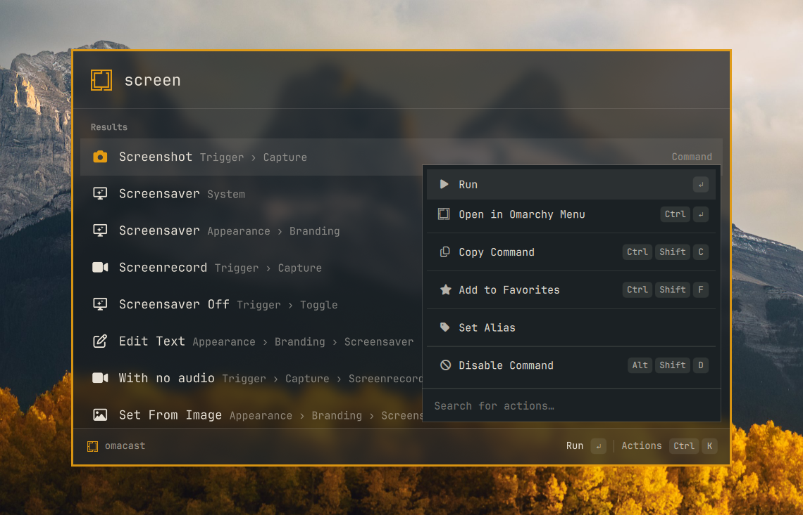
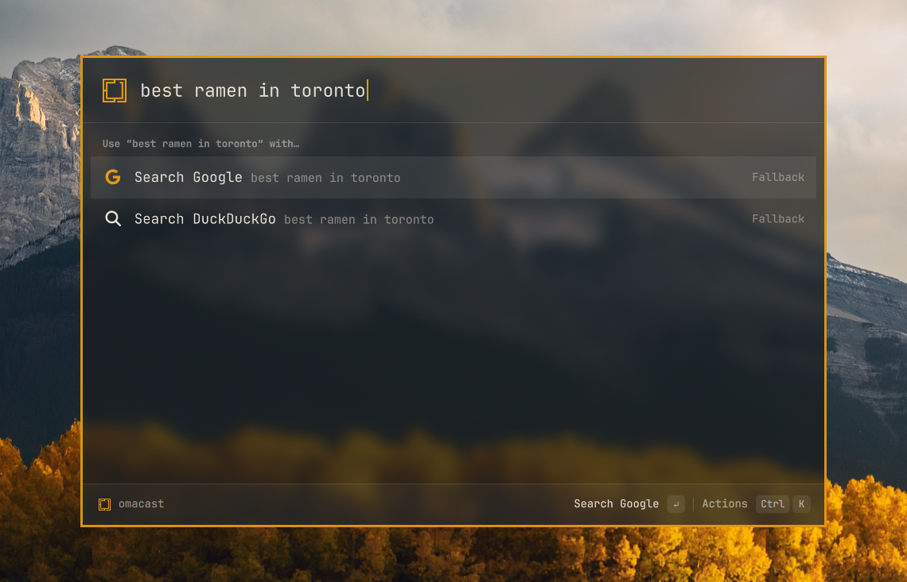

<div align="center">


# omacast

**A Raycast-esque launcher for [Omarchy](https://omarchy.org).**
It learns what you use, searches your apps and every Omarchy action, does the math, keeps your clipboard, and looks like it shipped with your theme.


</div>

---

## Why

Omarchy's built-in menu is great at what it does. omacast adds what Raycast users miss on Linux:

* **Learns your habits.** Results are ranked with a port of Raycast's root-search algorithm, plus frecency and learned search terms. The things you actually use float to the top, and if you type `ff` and pick Firefox, `ff` keeps meaning Firefox.
* **One search for everything.** Your apps, all ~400 Omarchy menu actions (with breadcrumbs and live ✓ state), a calculator, and web-search fallbacks.
* **Built-in commands.** Clipboard History, Emoji & Symbols, Switch Theme and Calculator History, each with an optional hotkey of its own.
* **Finds the window you already have.** `↵` on an app focuses its open window instead of starting another one.
* **Your shortcuts.** Give anything an alias, pin favorites, and hide the commands you never touch.
* **Keyboard-first.** A Ctrl+K action panel, Ctrl+1–9 quick picks, search history on ↑, section jumping, and emacs- or vim-style navigation.
* **Native to Omarchy.** It runs inside `omarchy-shell` as a plugin, with no Electron, no Node and no extra daemons. The window stays ready while hidden, so the hotkey opens it in a single frame, and it follows your theme live when you run `omarchy theme set`.

## Screenshots

<table>
  <tr>
    <td width="50%"></td>
    <td width="50%"></td>
  </tr>
  <tr>
    <td align="center"><b>Every Omarchy action, with breadcrumbs</b></td>
    <td align="center"><b>Ctrl+K: actions for any result</b></td>
  </tr>
</table>

<p align="center">
  
</p>
<p align="center"><b>No match? Send the query to Google or DuckDuckGo</b></p>

### Follows your Omarchy theme

There's no theme config. omacast binds to Omarchy's own colours, so it changes the moment you switch themes.
Under Omarchy's **Glassy Windows** (`omarchy hyprland window transparency glassy`) the card turns see-through
and Hyprland blurs what's behind it, like Omarchy's own menus.


## Install

Requires Omarchy 4 (Hyprland 0.56+, `omarchy-shell`). Install it from the
[Omarchy plugin marketplace](https://omarchyplugins.com/plugin.html?id=typecraft.omacast), or with:

```sh
omarchy plugin add https://github.com/typecraft-dev/oma-cast --enable
~/.config/omarchy/plugins/typecraft.omacast/bin/omacast install   # link the omacast CLI into ~/.local/bin
omacast setup hyprland                                              # bind Alt+Space
omacast doctor                                                      # check everything is wired up
```

Press **Alt+Space**. Super+Space stays the Omarchy menu.

`omacast setup hyprland` lists what it will change and asks before changing it. It writes
`~/.config/hypr/omacast.lua` and appends one `require("hypr.omacast")` line to
`~/.config/hypr/hyprland.lua`; it never edits Omarchy's own files. To use another key, edit
`omacast.lua`; setup never overwrites one that already exists. To bind it yourself instead, add
this to your Hyprland config:

```lua
o.bind("ALT + SPACE", "omacast launcher", hl.dsp.global("omacast:toggle"), { submap_universal = true })
-- While omacast is open it switches Hyprland to this submap, so Super+J/K reach the launcher.
hl.define_submap("omacast", function()
  hl.bind("SUPER + F24", hl.dsp.no_op()) -- a submap needs one bind to exist
end)
-- Blur behind the launcher under Glassy Windows.
hl.layer_rule({ match = { namespace = "^omacast$" }, blur = true, ignore_alpha = 0.3 })
```

An `omacast.lua` written by an older version has only the first line. Add the rest to get Super+J/K and the
glass blur; without the submap, Super+J/K stay Hyprland's and everything else works as before.

Update with `omarchy plugin update typecraft.omacast`.

### Remove

```sh
omacast uninstall      # asks to remove the hotkey, then runs: omarchy plugin remove typecraft.omacast
```

Or remove it by hand: `omarchy plugin remove typecraft.omacast`, then delete `~/.config/hypr/omacast.lua`
and the `require("hypr.omacast")` line in `~/.config/hypr/hyprland.lua`, and `~/.local/bin/omacast`.
Your data stays until you delete it: `~/.config/omacast`, `~/.local/share/omacast`, `~/.cache/omacast`
and `~/.local/state/omacast`.

## What's in the search

An empty search shows **Favorites**, **Suggestions** (what you use most), **Commands** and **Applications**.
Type, and you get ranked **Results**, a **Calculator** answer when the query is math, and `Use "<query>" with…`
web searches at the end. `Ctrl+P` filters the root to All, Applications or Commands.

- **Applications.** `↵` on an app focuses its most recently used window, switching to its workspace, raising
  it on floating workspaces and restoring it from the dock if it's minimized. It only launches the app when no
  window is open. Windows are matched by desktop id, `StartupWMClass`, or the URL Chromium and Brave web apps
  are named after. `Shift+↵` (Open New Window) always launches. Apps open through Omarchy's own launcher, so
  terminal apps go to `omarchy-launch-tui`.
- **The Omarchy menu.** Every action in the Omarchy menu is searchable from the root, with breadcrumbs like
  *Appearance › Windows*. Submenus open in place (search within them, `Esc` to go back), items Omarchy hides
  stay hidden, and toggles show their live ✓ state. `Ctrl+↵` opens an item in the Omarchy menu itself.
  **Omarchy Menu** opens the whole menu.
- **Web search.** **Search Google** and **Search DuckDuckGo** (alias `ddg`) take a query in an argument pill:
  `Tab` into it, type, `↵`.
- **Confirmations.** Shut Down, Restart, Log Out and Delete All Entries ask first (`↵` confirms, `Esc`
  cancels).
- **Feedback.** Results show toasts in the footer (`Ctrl+T` opens their actions, such as Undo after disabling a
  command or Copy Error Message after a failure), and a HUD through Omarchy's OSD when the window closes.

## Calculator

Type math straight into the search bar; the answer shows in a **Calculator** card above the results. omacast
has its own engine, so there's nothing to install.

| Kind | Try |
|---|---|
| Arithmetic and functions | `2^10`, `sqrt(2) * 10`, `sin(30°)` |
| Percentages | `$30 + 20%`, `20% off 50`, `50 as a % of 200` |
| ~250 units, including mixed units | `5 ft to cm`, `5 ft 3 in to cm`, `60 mph * 2 h`, `16px to rem` |
| ~160 currencies | `100 usd in eur`, `100 aed to inr` |
| Dates | `3 days from now`, `days until christmas` |
| Time zones | `time in tokyo`, `3pm london to nyc` |
| Number bases | `255 to hex` |
| Work time | `40 hours in work days` (a work week is 5 days) |
| Unix time | `unix 1700000000`, `1700000000 to date`, `now to unix` |

`↵` copies the answer, `Ctrl+↵` pastes it into the app you came from, and `Ctrl+Shift+C` copies
"question = answer". Each one is saved to **Calculator History** (searchable, kept for 90 days; `Ctrl+D`
deletes an entry, `Ctrl+Shift+D` deletes all). Trig takes radians unless you add `°` or `deg`.

Currency rates are central-bank reference rates (see [network access](#dependencies-and-network-access)).
`config.json` sets `remToPxRate` (16), `workHoursPerDay` (8) and `clockFormat` (`auto` follows your locale,
or `12h` / `24h`).

## Clipboard History

Search **Clipboard History** in the root search, or bind it directly:

```lua
o.bind("SUPER + CTRL + V", "omacast clipboard history", hl.dsp.global("omacast:clipboard"), { submap_universal = true })
```

Pressing the binding again closes it.

- omacast records text, links, colours, files and images you copy, with the app you copied from, when, and how many times.
- The list is on the left and a preview with its details is on the right, in Pinned, Today, Yesterday and Earlier sections. The type dropdown (`Ctrl+P`) filters by All Types, Text, Images, Files, Links or Colors.
- `↵` pastes into the app you came from, `Ctrl+↵` copies, `Ctrl+O` opens a link or file, `Ctrl+Shift+P` pins, `Ctrl+D` deletes an entry and `Ctrl+Shift+D` deletes everything except pins.
- Entries are kept for a week, as in Raycast. Pinned entries are always kept. Change it with `"clipboardHistoryDuration"` in `config.json` (`P1D`, `P1W`, `P1M`, `P3M`, `P6M`, `P1Y` or `unlimited`).
- Copies from password managers are never recorded: anything marked sensitive, plus the apps in `"clipboardDisabledApplications"` (Wayland app ids; KeePassXC, Bitwarden, 1Password and Seahorse by default). `"clipboardHistory": false` stops recording.
- The history is in `~/.local/share/omacast/db/clipboard.json`, and images and long text are in `~/.local/share/omacast/clipboard/`, both readable only by you.

## Emoji & Symbols

Search **Search Emoji & Symbols**, or bind it directly:

```lua
o.bind("SUPER + CTRL + SPACE", "omacast emoji", hl.dsp.global("omacast:emoji"), { submap_universal = true })
```

(Super+Ctrl+Space is Omarchy's background switcher by default; add `hl.unbind("SUPER + CTRL + SPACE")` first
to take it over.)

- An 8-column grid of every Unicode 17 emoji, with **Pinned** and **Recently Used** sections above the categories, and the selected emoji's name in the footer.
- Search by name, or by the keywords from Omarchy's own emoji picker (`lol`, `ship`…).
- Arrow keys move around the grid. `↵` pastes, `Ctrl+↵` copies, `Ctrl+Shift+C` copies the name, `Ctrl+Shift+P` pins, `Ctrl+D` removes one from Recently Used and `Ctrl+Shift+D` clears them all.
- Pick a skin tone from the action panel (`Ctrl+K`); it applies to every emoji that has one.

## Switch Theme

**Switch Theme** lists your Omarchy themes, your own and Omarchy's, with the current one checked and a preview of the highlighted theme beside the list. `↵` applies it with `omarchy-theme-set`, and omacast changes with it. It replaces Omarchy's own theme picker in omacast's results. To open it from Omarchy's theme keys as well:

```lua
hl.unbind("SUPER + CTRL + T")
o.bind("SUPER + CTRL + T", "omacast switch theme", hl.dsp.global("omacast:theme"), { submap_universal = true })
```

Pressing the key again closes it.

## Script Commands

Executable scripts in `~/.config/omacast/script-commands/` become commands, using the same
[Raycast Script Commands](https://github.com/raycast/script-commands) headers:

```bash
#!/bin/bash
# @raycast.schemaVersion 1
# @raycast.title Switch Display
# @raycast.mode silent
# @raycast.icon 🖥️
# @raycast.argument1 { "type": "dropdown", "placeholder": "Input", "data": [{"title": "Mac mini", "value": "x0091"}, {"title": "MacBook Pro", "value": "x00d0"}] }

monitor-input-cycle "$1" && echo "Switching display"
```

- Arguments (`text`, `password`, `dropdown`, up to three) appear as pills after the query: `Tab` moves into them,
  and `←`/`→` pick a dropdown option.
- The last line the script prints becomes the result: a HUD for `silent`, a toast for `compact`.
- `fullOutput` and `inline` scripts run as `compact` for now.
- `needsConfirmation` asks first, and `currentDirectoryPath` sets the folder the script runs in.
- The folder is rescanned each time the launcher opens. Scripts need `chmod +x` and a shebang.

## Keyboard

| Key | Does |
|---|---|
| `Alt+Space` | Open or close omacast |
| `↵` / `Ctrl+↵` / `Ctrl+Shift+↵` | Run the first, second or third action |
| `Shift+↵` | Open a new window of an app (`↵` switches to the one already open) |
| `Ctrl+K` | Open the action panel (type to filter it; each action shows its shortcut) |
| `Ctrl+1`…`9` | Pick a result |
| `↑` / `↓`, `Super+J` / `Super+K` | Move through results |
| `Ctrl+N` / `Ctrl+P` | Next / previous (emacs bindings; `Ctrl+P` moves up only inside popups) |
| `PageUp` / `PageDown` | Move eight results at a time |
| `Ctrl+↑` / `Ctrl+↓` | Jump between sections |
| `↑` on an empty search | Search history |
| `Ctrl+P` | Filter dropdown (All / Applications / Commands; types in Clipboard History) |
| `Tab` / `Shift+Tab` | Into and out of an argument pill |
| `Ctrl+Shift+F` | Add to or remove from favorites (`Ctrl+Alt+↑↓` to reorder) |
| `Ctrl+Shift+C` | Copy (the command, desktop id, answer or name) |
| `Alt+Shift+D` | Disable a command |
| `Ctrl+T` | Actions for the current toast (Undo, Copy Error Message) |
| `Ctrl+Shift+K` | About the selected result |
| `Super+V` / `Ctrl+V` / `Ctrl+Shift+V` / `Shift+Insert` | Paste text into the query (also accepts clipboard-history selections) |
| `Super+Backspace` | Clear the query |
| `Esc` / `Ctrl+[` / `Backspace` on an empty query | Back |
| `Shift+Esc` | Back to the root |
| `Ctrl +` / `Ctrl −` / `Ctrl 0` | Zoom |

With `"navigationBindings": "vim-motions"`, `Ctrl+J` / `Ctrl+K` move and the action panel moves to `Alt+K`.
Super+J/K need the `omacast` submap from [Install](#install).

## Settings

There's no settings window yet. Preferences live in two places.

**`~/.config/omacast/config.json`.** Create it and add only what you want to change. omacast picks up changes
as soon as you save; an unreadable file falls back to the defaults and logs a warning.

| Key | Default | Does |
|---|---|---|
| `currencyRates` | `true` | Download daily exchange rates for the calculator |
| `remToPxRate` | `16` | Pixels per rem |
| `workHoursPerDay` | `8` | Hours in a work day |
| `clockFormat` | `"auto"` | `"auto"`, `"12h"` or `"24h"` |
| `rootFilter` | `true` | `false` hides the All / Applications / Commands dropdown and its shortcut |
| `keepVisibleOnFocusLoss` | `false` | `true` keeps the launcher open when you click outside it |
| `clipboardHistory` | `true` | `false` stops recording (the history stays) |
| `clipboardHistoryDuration` | `"P1W"` | How long unpinned entries are kept |
| `clipboardDisabledApplications` | password managers | Wayland app ids whose copies are never recorded |
| `logLevel` | `"info"` | How much omacast writes to the shell log |

**General settings,** set through the CLI (it checks each value):

```sh
omacast call settings.getGeneralSettings
omacast call settings.updateGeneralSettings '{"navigationBindings":"vim-motions"}'
```

| Setting | Values |
|---|---|
| `navigationBindings` | `emacs` or `vim-motions` |
| `windowMode` | `expanded`, or `compact` (only the search bar until you type) |
| `escapeKeyBehavior` | `pop-back-or-close` or `close-and-pop-to-root` |
| `popToRootTimeout` | Seconds before a closed launcher resets to the root (default 90) |
| `rootSearchSensitivity` | `low`, `medium` or `high` |
| `uiZoom` | A number like `1.1` (`Ctrl +` / `−` / `0` set it too) |

Aliases, favorites and disabled commands are set from the launcher (`Ctrl+K` on a result). To re-enable a
disabled command, use Undo on the toast (`Ctrl+T`), or remove its `"enabled": false` from
`~/.local/share/omacast/db/settings.json`.

## CLI

```sh
omacast toggle | show | hide
omacast run <commandId>         # e.g. builtin:emoji-picker, app:com.mitchellh.ghostty, omarchy:appearance.theme
omacast call <method> [json]    # call any backend method; omacast call system.info lists them
omacast doctor                  # checks the shell, IPC, the backend, QML errors in the shell log, and the hotkey
omacast setup hyprland [--yes]
omacast build-search            # build the optional search helper (needs cargo)
omacast install | uninstall
```

Global shortcuts for Hyprland binds: `omacast:toggle`, `omacast:clipboard`, `omacast:emoji`, `omacast:theme`.
Bind them with `submap_universal = true` so they still work while omacast is open.

### Dependencies and network access

omacast needs only what Omarchy ships: `omarchy-shell` (Quickshell), Hyprland, bash, `jq` and `socat`.
It adds no packages and no background services.

- **Superwhisper recording indicator.** When `python3` with PyGObject is installed, the
  plugin runs `services/superwhisper-frame.py` alongside the shell. While the launcher is open it tells
  [Superwhisper](https://superwhisper.com) where the card is over the session bus
  (`com.superwhisper.ShellOverlay`), so Superwhisper's recording glow or pill draws on the launcher instead
  of the window under it. It makes no network requests, and does nothing without Superwhisper.
- **Currency rates.** When you open the launcher and its rates are over 12 hours old, the calculator downloads
  central-bank exchange rates from `api.frankfurter.dev` (retrying 30 minutes after a failure) and caches them in
  `~/.cache/omacast/currencies.json`. This is the only network request omacast makes. Turn it off with
  `"currencyRates": false` in `~/.config/omacast/config.json`.
- **Optional search helper.** With Rust (`cargo`) installed, `omacast install` (or `omacast build-search`)
  builds the small **flea-search** helper from `search/` on your machine. It matches titles, alternate names,
  subtitles and keywords outside the shell's UI thread and tolerates transposed or missing letters, and it
  also searches the emoji list. Nothing is downloaded prebuilt. Without it, omacast uses the built-in matcher,
  so a marketplace install works without Rust. Aliases, favorites, learned terms and frecency stay in
  omacast's ranker either way. If the helper fails or times out, search falls back to the built-in matcher
  until the plugin reloads. Rebuild it after `omarchy plugin update`.

### Privacy

Your search history, learned search terms, calculator history and clipboard history stay on your machine, in
owner-only files: omacast creates its `~/.config`, `~/.local/share`, `~/.cache` and `~/.local/state`
directories as `0700` and its database files as `0600`, and tightens any it finds readable by other users.
Text you copy or paste goes to `wl-copy` on stdin, never on a command line, so other local users can't read it
from the process list. Paste sends Ctrl+Shift+V to terminals (Alacritty, Kitty, Ghostty, foot, WezTerm,
Konsole, GNOME Terminal, Ptyxis, Herdr) and Shift+Insert everywhere else, as Omarchy's clipboard history does.
The one exception is a script command's arguments: they reach your script as `$1`…`$3`, so they are on its
command line while it runs.

### Upgrading from oma-cast

The plugin used to be `typecraft.oma-cast`. On first start, omacast moves your `oma-cast` config, data,
cache and state directories to the `omacast` names. In a development checkout, `bin/omacast install` removes
the old plugin link and `~/.local/bin/oma-cast`, and `omacast setup hyprland` moves `oma-cast.lua` to
`omacast.lua`, keeping your key. `omacast doctor` reports anything left over.

## Roadmap

omacast is early. Search, ranking and the Omarchy integration are done.

Done:

- [x] Root search with Raycast's ranking, frecency, aliases and favorites
- [x] The whole Omarchy menu
- [x] Calculator and Calculator History
- [x] Clipboard History
- [x] Emoji & Symbols
- [x] Switch Theme
- [x] Script Commands (arguments, confirmation)

Next:

- [ ] Settings view (General, Commands, Calculator, Scripts)
- [ ] Script Commands: the `fullOutput` view and `inline` refresh
- [ ] `omacast://` deep links

Later:

- [ ] Quicklinks
- [ ] Snippets and text expansion
- [ ] Running Raycast extensions built from the open-source [`raycast/extensions`](https://github.com/raycast/extensions) repo
- [ ] Window management and a window switcher
- [ ] File search
- [ ] Importing your `.rayconfig` from macOS

The full plan is in [`SPEC.md`](SPEC.md).

## Development

```sh
git clone https://github.com/typecraft-dev/oma-cast.git
cd oma-cast
bin/omacast install         # symlink this checkout into omarchy-shell instead of a marketplace copy
node --test tests/*.test.js # unit tests, no npm install needed
tests/smoke.sh              # live checks against the running shell
omacast dev                 # reload on every save
```

Remove a marketplace install first (`omarchy plugin remove typecraft.omacast`); both use the same plugin id.
Quickshell caches QML for the life of the process, so run `omacast reload` after editing a checkout. See [`CLAUDE.md`](CLAUDE.md) for the layout and conventions.

The website is in [`site/`](site/README.md): a static page deployed to Cloudflare. Its "Try it" launcher is these same `core/*.js` modules running in the browser.

## Notes

omacast is an independent, clean-room project. It isn't affiliated with or endorsed by Raycast, and it contains no Raycast code or assets. It never contacts Raycast's servers, has no telemetry, and has no AI features.
